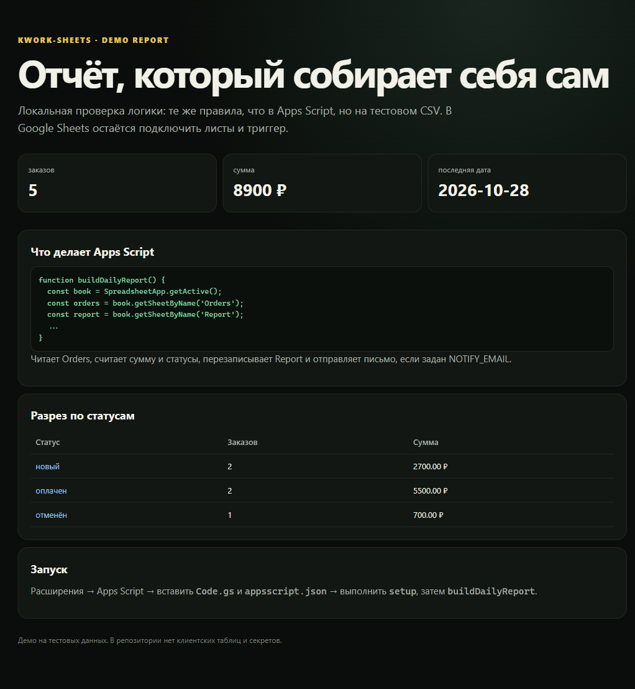

# kwork-sheets

Автоматизация Google Sheets на Apps Script: собрать отчёт по заказам, записать его на отдельный лист и отправить письмо владельцу. Локальная логика проверяется на тестовом CSV, поэтому репозиторий можно проверить без клиентской таблицы.



## Что работает

- лист `Orders` с колонками `date`, `customer`, `status`, `amount`;
- отчёт на листе `Report`: количество, сумма, последняя дата, разрез по статусам;
- денежные форматы `1 500,50 ₽`, `2 000`, `1500.50`;
- меню «Отчёты» в Google Sheets;
- опциональное письмо на `NOTIFY_EMAIL` из Script Properties;
- локальный Python-мок той же логики и тесты.

## Быстрый старт в Google Sheets

1. Создайте таблицу и откройте **Расширения → Apps Script**.
2. Вставьте `apps-script/Code.gs` и `apps-script/appsscript.json`.
3. Выполните `setup` и разрешите доступ.
4. Заполните лист `Orders`.
5. Выполните `buildDailyReport` или выберите **Отчёты → Собрать отчёт**.

Чтобы включить письмо, добавьте в **Project Settings → Script Properties**:

```text
NOTIFY_EMAIL=owner@example.com
```

Триггер по расписанию: **Triggers → Add Trigger → buildDailyReport → Time-driven → Day timer**.

## Локальная проверка

```bash
python -m unittest discover -s tests -v
python scripts/build_demo.py
```

Демо читает `mock/sample_orders.csv`, создаёт `demo/report.json` и `demo/index.html`. Это проверка логики, а не эмуляция Google Sheets API.

## Ограничения

- Apps Script нельзя выполнить локально; локальный мок проверяет только расчёты.
- Нет OAuth-клиента, установки `clasp` и деплоя из CI.
- Нет произвольных формул, сводных таблиц и сложных схем.
- Нет отправки в Telegram и CRM; это отдельные карточки.
- Ссылки на клиентские таблицы и почтовые адреса в репозиторий не попадают.
- Перед подключением к рабочей таблице сделайте копию.

## Структура

```text
apps-script/   Code.gs и appsscript.json
mock/          CSV и локальная логика отчёта
tests/         unittest
scripts/       сборка демо
demo/          отчёт и HTML
docs/          архитектура
```

## Лицензия

MIT.
